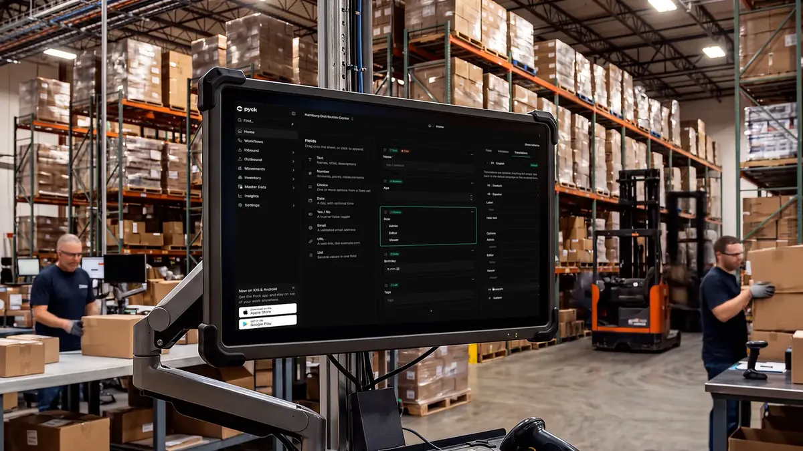
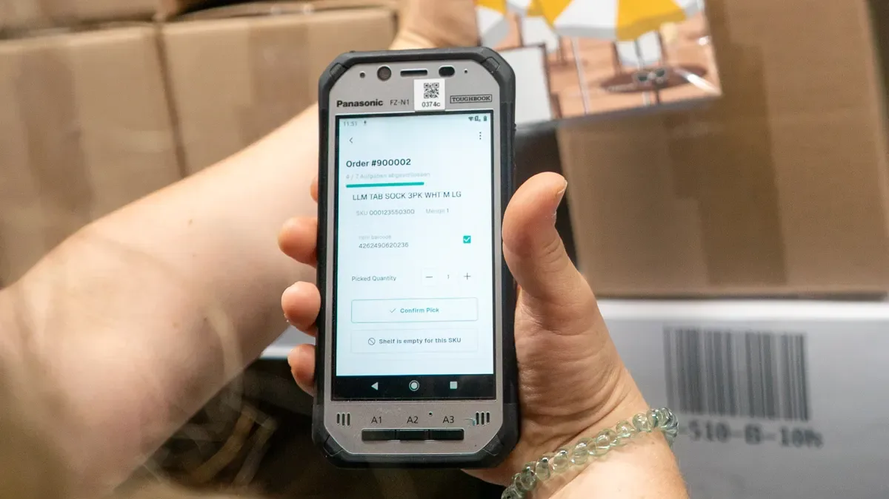

  <a href="https://pyck.ai">
    <picture>
      <source media="(prefers-color-scheme: dark)" srcset="https://raw.githubusercontent.com/pyck-ai/.github/main/profile/assets/pyck-white.svg">
      <source media="(prefers-color-scheme: light)" srcset="https://raw.githubusercontent.com/pyck-ai/.github/main/profile/assets/pyck-black.svg">
      
    </picture>
  </a>

<h1 align="center">The last warehouse software you will ever need.</h1>

  <b>Your warehouse software, modeled around how you work. Not the other way around.</b> 
  Pyck uses AI to model the WMS around your processes, so you never bend your workflows to fit it.

  
  
  
  

<table>
  <tr>
    <td width="50%"></td>
    <td width="50%"></td>
  </tr>
  <tr>
    <td align="center"><b>Pyck Control</b>, the web app for the office</td>
    <td align="center"><b>Pyck Mobile</b>, the app on the warehouse floor</td>
  </tr>
</table>

  <b>Two devices, one workflow.</b> The office tracks, the floor executes. You change a workflow once and it changes everywhere.

  <b>Software that follows your business.</b> A traditional WMS pushes you into its standard. Pyck follows the processes you run in your warehouse. AI drafts the workflows, screens and branching from how you work today, and a human approves every BPMN diagram before it deploys. Stock levels and movement rules are never generated.

<table>
  <tr>
    <th width="33%" align="left">🏭 For warehouse operators</th>
    <th width="33%" align="left">🛠️ For developers</th>
    <th width="33%" align="left">🤝 Join us</th>
  </tr>
  <tr>
    <td valign="top">
      Receiving to shipping, deployed zone by zone next to your existing software. Up to <b>70% lower TCO</b> than traditional tier 1.  
      <a href="https://ask.pyck.ai"><b>Design a workflow with Piko</b></a> 
      <a href="https://eu.pyck.cloud/auth/signup-go">Create a free account</a> 
      <a href="https://pyck.ai/pricing">See pricing</a>
    </td>
    <td valign="top">
      Core in Go, workflows on Temporal and BPMN 2.0, a public GraphQL API. Self-hosting is built in.  
      <a href="https://docs.pyck.cloud"><b>Read the docs</b></a> 
      <a href="https://github.com/pyck-ai/pyck-oss">Browse the open core</a> 
      <a href="https://github.com/pyck-ai/pyck-cli">Get the CLI</a>
    </td>
    <td valign="top">
      A remote-first team of engineers and logistics people. Our code is public, so you can judge us before you apply.  
      <a href="https://join.slack.com/t/pyck-community/shared_invite/zt-3ulnckg7r-kBk6Spkeyk_DldYQpDmcxA"><b>Join our Slack</b></a> 
      <a href="mailto:hello@pyck.ai">Email us</a> 
      <a href="https://pyck.jobs.personio.com/">See open roles</a>
    </td>
  </tr>
</table>

  Questions? <a href="https://ask.pyck.ai">Ask Piko</a>, our free AI assistant, anything about Pyck, or <a href="mailto:hello@pyck.ai">email us</a>.

  <b>pyck GmbH</b>, Schwäbisch Hall. Founded by Daniel Jarr (CEO), Maximilian Mack (CTO) and Matthias Nagel (COO) to let users build their own logistics software. Our vision: in 2035, every physical product in the world will have a point of contact with Pyck. · Pyck is pronounced /pɪk/

